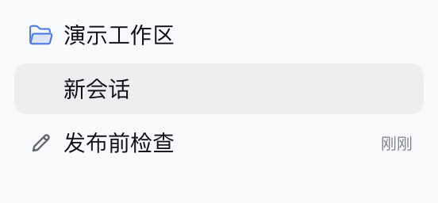
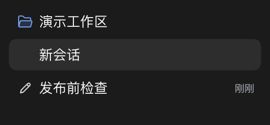

# Session draft

[简体中文](README.zh.md)

An idle conversation with unsent text shows a pencil beside its title in the sidebar.
Native activity, approval and unread completion indicators have priority.
The pencil uses the normal session row's leading slot, which is unavailable on blank and archived rows.

With **Three sidebar list modes** enabled, drafted sessions stay in **Needs attention**.

Requires DeepSeek Harness 0.2.2-rc.5 or newer.
Enable **Session draft** in **List Modular Improvement Plan**.
For a standalone install from source, run `pnpm install` in the checkout to build the plugin,
then select that directory in **Plugins → Add plugin**.

[Project documentation](docs/README.md)

## Screenshots

The pencil marks an idle session that still has unsent text.
The screenshots show the Chinese interface.

| | Light | Dark |
| --- | --- | --- |
| Draft marker |  |  |
