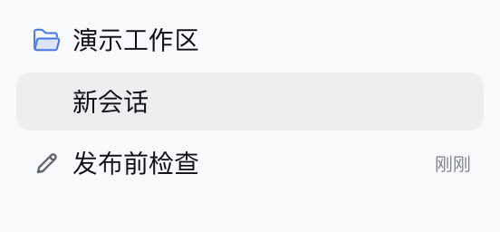
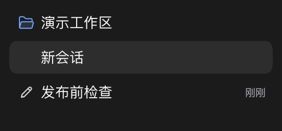

# 会话草稿

[English](README.md)

空闲会话的输入框有未发送文字时，侧栏标题左侧显示铅笔。
原生的运行、待审批和未读完成提示优先。
铅笔使用原生会话行左侧插槽，原生空白行和归档行没有这个插槽。

与 **左侧栏列表三态切换** 同时启用时，有草稿的会话会留在「需关注」列表中。

需要 DeepSeek Harness 0.2.2-rc.5 或更新版本。可在「工作区模块化改良计划」内启用「会话草稿」。
若从源码独立安装，先在检出目录运行 `npm ci` 构建插件，再在「插件 → 添加插件」中选择该目录。

[项目文档](docs/README.md)

## 界面截图

侧栏中的铅笔标出有未发送文字的空闲会话。

| | 浅色 | 深色 |
| --- | --- | --- |
| 草稿标记 |  |  |
